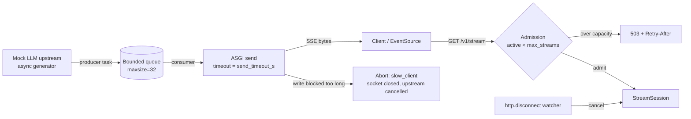

# sse-streaming-gateway

A FastAPI gateway that streams LLM tokens to clients over Server-Sent Events, with real backpressure: a bounded queue per connection, slow-client cut-off, cancellation on disconnect, and admission control. The upstream is a mock LLM, so the repo runs offline. A load test measures how many concurrent streams one process held on a laptop.

## What it is
- `GET /v1/stream` and `POST /v1/chat/stream` return `text/event-stream` (`event: token`, `event: done`, `event: error`, `: ping` heartbeats).
- Each connection gets a `StreamSession`: a producer task pulls tokens from the upstream into an `asyncio.Queue(maxsize=N)`; the consumer writes them to the socket.
- `GET /metrics` exposes active / peak / completed / disconnects / slow-client aborts / rejected / tokens sent.

## Why
Token streaming fails in quiet ways. A client on a bad network stops reading, the server keeps generating, and memory grows per connection. A user closes the tab, and the model call keeps running and billing. This gateway makes each of those cases explicit and tested.

## Architecture


## How it works
| Concern | Mechanism | Where |
|---|---|---|
| Backpressure | Producer `await queue.put()` blocks when the queue is full, so the upstream is not pulled again until the client drains | `sse_gateway/session.py` |
| Slow client | Each socket write is wrapped in `asyncio.wait_for(send, send_timeout_s)`; a timeout aborts the stream and cancels upstream | `StreamSession.pump` |
| Cancellation | A task watches `receive()` for `http.disconnect` and cancels the producer, which closes the upstream generator | `SSEResponse.__call__` |
| Upstream failure | Exception mid-stream becomes an `event: error` with the token count so far | `_produce` |
| Idle connections | `: ping` comment every `heartbeat_s` while upstream is silent (long prefill) | `events()` |
| Admission | Requests beyond `max_streams` get `503` + `Retry-After: 1` | `create_app` |

## Results
### Load test — MEASURED
Run: `python3 bench/load_test.py --levels 100 1000 2500 5000 10000 --tokens 200 --delay-ms 100`. Raw output: [`results/load_test.json`](results/load_test.json).

Setup: one uvicorn worker (stdlib asyncio loop, h11 parser, no uvloop), client and server on the same Mac (Mac14,10, 12 logical CPUs, macOS 26.7.1, Python 3.12.4). Each stream is 200 tokens at 100 ms per token (ideal duration 20 s). Clients ramp at 1,000 connections/s from one asyncio process.

| Concurrent streams | Completed | TTFT p50 | TTFT p95 | Stream duration p50 (ideal 20 s) | Tokens/s delivered | Server peak RSS |
|---|---|---|---|---|---|---|
| 100 | 100/100 | 27 ms | 29 ms | 20.2 s | 980 | 50 MB |
| 1,000 | 1,000/1,000 | 23 ms | 59 ms | 20.8 s | 9,098 | 70 MB |
| 2,500 | 2,500/2,500 | 81 ms | 243 ms | 27.7 s | 16,552 | 121 MB |
| 5,000 | 5,000/5,000 | 428 ms | 2,060 ms | 63.1 s | 14,757 | 202 MB |
| 10,000 | 10,000/10,000 | 1,205 ms | 14,124 ms | 130.7 s | 13,192 | 360 MB |

How to read it:
- **10,000 concurrent SSE connections were held open and all completed** with zero connect errors, zero early EOFs and zero dropped streams.
- **But one process saturates near 2,500 streams.** Delivered throughput peaks at ~16.5k tokens/s; past that, per-stream rate falls (streams take 3–6.5× their ideal time) and TTFT p95 climbs into seconds. "Holds 10k connections" is true; "serves 10k streams at full speed" is **not** true on one worker.
- The client shares the CPU with the server, so these are conservative. Next steps to measure: uvloop + httptools, multiple workers, client on a separate machine.

### Slow-client and cancellation behaviour — tested
Covered by the integration tests (real uvicorn on a local port), not by a benchmark:
- A raw socket that sends a request and never reads is cut off (`slow_client_aborts == 1`), queue depth never exceeds 8, and the stream stops far before its 100,000 tokens.
- Closing the client mid-stream cancels the upstream (`client_disconnects == 1`, `completed == 0`).

## Tests
18 tests (`pytest`): 10 unit tests on `StreamSession` / mock upstream (SSE framing, determinism, bounded queue pauses the producer, slow-client abort, cancel during TTFT, upstream error event, heartbeats, OSError as disconnect) and 8 integration tests against a live uvicorn server (GET/POST end-to-end, validation, 503 admission, disconnect cancels upstream, raw-socket slow client, 50 concurrent isolated streams, metrics).

```
$ python3 -m pytest -q
..................                                                       [100%]
18 passed in 3.33s
```

## Run it
```bash
pip install -r requirements.txt
python3 -m pytest -q
uvicorn sse_gateway.app:app --port 8000
curl -N "localhost:8000/v1/stream?prompt=hello+world&max_tokens=20&delay_ms=50"
python3 bench/load_test.py --levels 100 1000      # short load test
```

## Limits
- The upstream is a mock async generator. No real model or provider SDK is called.
- One worker, one host. No horizontal scaling, no sticky sessions, no resume via `Last-Event-ID`.
- Slow-client detection relies on the socket write blocking; on loopback, kernel buffers are large, so detection needs large or many tokens.
- Admission control is per process (an in-memory counter), not cluster-wide.
- No auth or rate limiting per tenant.

## Stack
Python 3.12 · FastAPI · Starlette raw ASGI response · uvicorn · asyncio · pytest · httpx

## License
MIT
